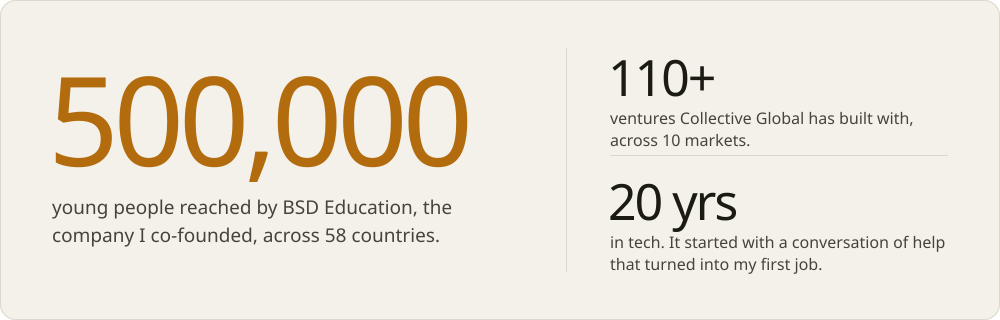

<a href="https://nickeykhem.com">
  <picture>
    <source media="(prefers-color-scheme: dark)" srcset="assets/hero-dark.svg">
    
  </picture>
</a>

  

I'm Nickey, a technologist from Hong Kong. For twenty years I've built alongside founders, taught the next generation, and stepped on stage to make technology make sense for any room. I don't coach from the sidelines: I sit by your side, and we build things together.

**[nickeykhem.com](https://nickeykhem.com)** &nbsp;&nbsp; [Collective Global](https://collectiveglobal.net) &nbsp;&nbsp; [LinkedIn](https://www.linkedin.com/in/nickeykhem/) &nbsp;&nbsp; [YouTube](https://www.youtube.com/@nickeykhem)

 

## Where I build

**[Collective Global](https://collectiveglobal.net)**, founder. A global venture collective. We build and operate alongside founders, companies and funds, from the first line of code to running a whole portfolio, and we stay in it for the long run.

**[BSD Education](https://bsd.education)**, co-founder and CTO. Chris Geary and I saw the same problem. I built the platform, designed the curriculum and led the teaching approach. Thirteen years on, it has reached close to half a million young people.

**[RefuGeek](https://refugeek.org)**, giving back. Teaching tech skills to refugees, because it only takes one opportunity.

**Off the clock**, I'm usually putting AI agents to work on real problems. Most of those experiments live in private repos until they're ready to share.

 

<picture>
  <source media="(prefers-color-scheme: dark)" srcset="assets/numbers-dark.svg">
  
</picture>

  

<picture>
  <source media="(prefers-color-scheme: dark)" srcset="assets/ventures-dark.svg">
  
</picture>

The same data as a table

 

| Sector | Ventures |
| :-- | --: |
| FinTech | 14 |
| HealthTech | 10 |
| AI | 9 |
| Cleantech | 8 |
| Marketplaces | 8 |
| SaaS | 8 |
| Supply chain and logistics | 8 |
| PropTech | 7 |
| HR Tech | 6 |
| 13 more sectors, from EdTech and Construction to BioTech and LegalTech | 32 |
| **Total** | **110** |

More at [collectiveglobal.net](https://collectiveglobal.net).

 

## On stage

My signature keynote is **In the AI age, the generalist wins.** The world says niche down. I think that's backwards: AI is the great amplifier of breadth.

I also speak on practical AI and agents for non-technical teams, and on building ventures in the AI age. Keynotes, panels, moderation, and hands-on workshops, which are my favourite format.

Rooms I've spoken in include She Loves Data, AWE Asia, CreativeMornings Hong Kong, EdTech Asia, Startup Launchpad, 21CLC and the Kids4Kids Youth Summit. Along the way the World Economic Forum named me a Global Shaper, and Prestige Hong Kong listed me in its 40 Under 40.

**[Invite me to speak →](https://www.linkedin.com/in/nickeykhem/)**

 

## Learnings

Things I've figured out, written for founders, operators and the curious. More at [nickeykhem.com/learnings](https://nickeykhem.com/learnings/).

| Read | In short |
| :-- | :-- |
| [Bootstrapping is the new default. Building alone is not.](https://nickeykhem.com/learnings/bootstrapping-is-the-new-default/) | AI made building cheap. That changes who you hire next. |
| [In the AI age, the generalist wins](https://nickeykhem.com/learnings/in-the-ai-age-the-generalist-wins/) | AI is the great amplifier of breadth. |
| [Practical AI: what to build first](https://nickeykhem.com/learnings/practical-ai-what-to-build-first/) | A non-technical starting point for putting agents to work this week. |
| [How VCs are starting to look at AI startups](https://nickeykhem.com/learnings/how-vcs-look-at-ai-startups/) | What changed in how investors size up an AI company. |
| [Why founders fear the build](https://nickeykhem.com/learnings/why-founders-fear-the-build/) | It isn't the tech. It's not having the controls. |

 

## How I build

Stack agnostic, on purpose. Pick the tool for the problem, and stop marrying a stack. Lately that means `TypeScript` and `Astro` on the web, `Python` for data and automation, `Swift` when it has to live on the Mac, `AWS Lambda` and `Cloudflare Workers` to ship it, and `Claude` with agent tooling to do the heavy lifting.

 

---

It only takes one opportunity. Have an idea, a company, or a portfolio? **[Work with me at Collective Global ↗](https://collectiveglobal.net)**
